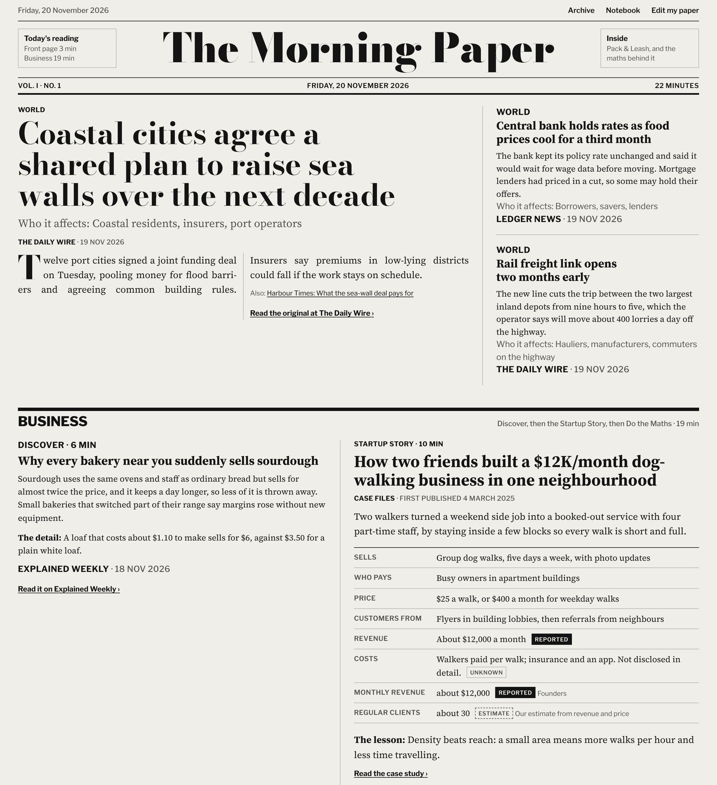

# The Morning Paper

My own newspaper. Runs on my laptop.

Why build this? Feeds don't end. I wanted one thing in the morning that does - a front page I can
skim in five minutes, deeper stuff if I've got time, a link to the original on every story. Then done.

## How it works

Three boxes, plain words:

- **Interests** - what I like reading about
- **Goals** - what I'm trying to figure out
- **Always on** - what it covers every day, no matter what

The paper turns that into its own plan - sections, sources, how it picks stories. Every morning it
pulls the sources, drops duplicates and old news, writes short briefs, checks links, dates and maths,
then publishes. Once it's out it doesn't change. Old papers sit in the archive.

Random question during the day? Dump it in the **Notebook**. Tomorrow's paper digs into it -
with sources, not vibes.

## Running it

Refer to [CLAUDE.md](CLAUDE.md).

### Mac app

`mac/build-app.sh --dock` builds `~/Applications/Morning Paper.app` and pins it to the Dock.
One click starts the server if it isn't running, makes today's edition if there isn't one yet,
and opens the paper in the browser. Re-run the script if the project folder or `uv` moves.
